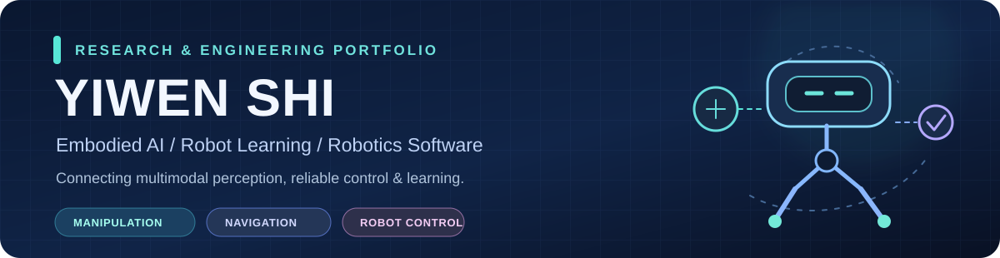

  

# Robotics · Motion Control & Navigation

[中文](README.zh-CN.md) | English

My academic background is in **Intelligent Construction**, and my work focuses on **robotics and embodied intelligence**.

I am seeking a robotics internship focused on motion control or localization and navigation. I develop robot kinematics and trajectory software, teleoperation systems, and reproducible evaluation pipelines for learning-based robot policies.

## Selected project portfolio

| Project | Technical focus | Current scope |
|---|---|---|
| **[UR5 / Franka Control Lab](https://github.com/415Aurora/ur5-control-lab)** | Quintic joint trajectories, KDL-based kinematics and dynamics, null-space motion, MoveIt integration | Public UR5 code and visual results; the Franka/null-space extension remains local. No physical-robot accuracy claim |
| **[RoboNeck-AVP](https://github.com/415Aurora/RoboNeck-AVP)** | Head-pose retargeting, calibration, EMA smoothing, asynchronous motor control and latency diagnostics | Two-axis teleoperation; end-to-end hardware timing still requires measured evidence |
| **[CraneVLA](https://github.com/415Aurora/CraneVLA)** | Unity/PICO demonstrations, LeRobot data contracts, π0.5 SFT adaptation and paired policy evaluation | Public showcase with figures and scalar CSVs; full training/simulation code and model weights are not published |
| **[JEV-Navi](https://github.com/415Aurora/jev-navi)** | Frozen multimodal navigation policies, depth-based action checks, trajectory metrics and failure diagnosis | A navigation experiment framework; current diagnostic runs do not establish successful navigation or a SLAM system |

### Explore the evidence

- **[UR5 / Franka visual results](https://github.com/415Aurora/ur5-control-lab/blob/master/docs/visual-results.md):** simulation scene, joint-centering gain sweep and source data. The gallery distinguishes local extensions from the code currently published.
- **[RoboNeck-AVP repository](https://github.com/415Aurora/RoboNeck-AVP):** software architecture, setup and tests for head-pose teleoperation.
- **[CraneVLA visual results](https://github.com/415Aurora/CraneVLA/blob/main/docs/visual-results.md):** paired training curves, occlusion interventions and archived training scalars. A lower auxiliary loss is not a closed-loop success result.
- **[JEV-Navi repository](https://github.com/415Aurora/jev-navi):** navigation protocols, trajectory logging and failure diagnostics. Navigation evaluation is distinct from localization and mapping.

## My contribution

I independently developed the custom software, algorithm implementations, integration and experiment workflows described above. For CraneVLA, a collaborator created the base Unity model from my project concept. For RoboNeck-AVP, a collaborator designed the mechanical structure from my concept; I developed the teleoperation software.

These projects build on established open-source tools and vendor SDKs. ROS, MoveIt, KDL, RLinf/OpenPI, Habitat and device SDKs are credited to their respective authors; my work focuses on project-specific implementation, adaptation and evaluation.

## Engineering interests

- **Motion and geometry:** coordinate frames, Jacobians, trajectory interpolation, redundancy resolution and control timing.
- **Robot software:** Python, NumPy, ROS, MoveIt, Gazebo, hardware adapters and simulator interfaces.
- **Learning-based systems:** demonstration alignment, action-window semantics, dataset separation and controlled comparisons.
- **Evaluation:** explicit failure cases, complete denominators, traceable configurations and reproducible experiment records.

## Current priorities

Strengthen measured trajectory tracking and teleoperation benchmarks, consolidate CraneVLA experiment provenance, and extend existing sensor workflows toward evaluated localization and odometry baselines.

I value clear boundaries between an implemented interface, a passing software test and a verified robot capability.

## Additional projects

- [Grasp-XR-Teleop](https://github.com/415Aurora/Grasp-XR-Teleop) — humanoid XR teleoperation and manipulation experiment workflows built on an upstream ecosystem.
- [OpenGlasses](https://github.com/415Aurora/OpenGlasses) — camera transport and multimodal interaction prototyping.
- [SteelMind](https://github.com/415Aurora/SteelMind) — engineering workflows and document generation.

[All repositories](https://github.com/415Aurora?tab=repositories) · [GitHub](https://github.com/415Aurora)
