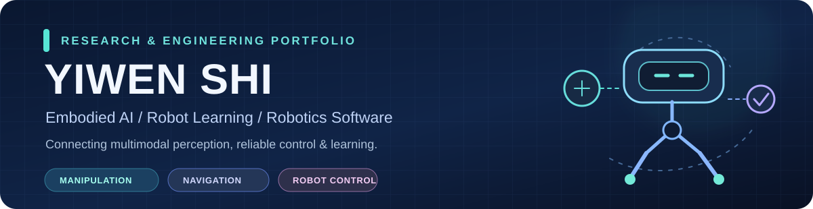

  

# 机器人算法 · 运动控制与导航

中文 | [English](README.md)

具有**智能建造**学术背景，研究与开发兴趣集中在**机器人与具身智能**。

正在寻找机器人运动控制或定位导航方向的实习机会。围绕机器人运动学、轨迹生成、遥操作，以及学习型机器人策略的可复现实验开展软件与算法开发。

## 核心项目组合

| 项目 | 技术重点 | 当前验证范围 |
|---|---|---|
| **[UR5 / Franka Control Lab](https://github.com/415Aurora/ur5-control-lab)** | 五次多项式关节轨迹、基于KDL的运动学与动力学、零空间运动、MoveIt集成 | 已公开UR5代码和可视化；Franka/零空间扩展源码仍在本地，不作真机精度宣称 |
| **[RoboNeck-AVP](https://github.com/415Aurora/RoboNeck-AVP)** | 头部姿态重定向、标定、EMA平滑、异步电机控制与延迟诊断 | 双轴遥操作；端到端硬件时延需要进一步实测 |
| **[CraneVLA](https://github.com/415Aurora/CraneVLA)** | Unity/PICO示教、LeRobot数据契约、π0.5 SFT适配与配对策略评测 | 公开仓库提供图表与标量CSV；完整训练/仿真源码和模型权重尚未公开 |
| **[JEV-Navi](https://github.com/415Aurora/jev-navi)** | 冻结多模态导航策略、深度动作检查、轨迹指标与失败诊断 | 导航实验框架；当前诊断尚未证明成功导航或完整SLAM能力 |

### 项目证据入口

- **[UR5 / Franka可视化结果](https://github.com/415Aurora/ur5-control-lab/blob/master/docs/visual-results.md)：** 仿真场景、关节居中增益对比与源数据，明确区分本地扩展和当前公开代码。
- **[RoboNeck-AVP仓库](https://github.com/415Aurora/RoboNeck-AVP)：** 头部姿态遥操作的软件架构、运行说明与测试。
- **[CraneVLA可视化结果](https://github.com/415Aurora/CraneVLA/blob/main/docs/visual-results.md)：** 配对训练曲线、遮挡干预和训练标量；辅助损失下降不直接等于闭环成功。
- **[JEV-Navi仓库](https://github.com/415Aurora/jev-navi)：** 导航实验协议、轨迹记录和失败诊断；导航评估与定位建图能力分别说明。

## 个人贡献

上述项目中的自有软件、算法实现、系统集成和实验流程由我独立完成。CraneVLA的基础Unity模型由协作者依据我的项目思路完成；RoboNeck-AVP的机械结构由协作者依据我的思路设计，遥操作软件由我开发。

项目基于成熟开源工具与设备SDK开展。ROS、MoveIt、KDL、RLinf/OpenPI、Habitat及厂商SDK保留上游归属；我的工作集中在具体任务的软件实现、适配与实验评估。

## 技术关注

- **运动与几何：** 坐标系、Jacobian、轨迹插值、冗余解析与控制时序。
- **机器人软件：** Python、NumPy、ROS、MoveIt、Gazebo、硬件适配与仿真接口。
- **学习型系统：** 示教时序对齐、动作窗口语义、数据划分与受控对比。
- **实验评估：** 保留失败案例、完整统计分母、冻结配置并记录可追溯产物。

## 正在补强

完善轨迹跟踪与遥操作量化实验，统一CraneVLA实验来源，并基于已有传感器工作流推进经过评测的定位和里程计基线。

重视接口实现、软件测试与机器人实测能力之间的证据边界。

## 补充项目

- [Grasp-XR-Teleop](https://github.com/415Aurora/Grasp-XR-Teleop) — 基于上游生态的人形机器人XR遥操作与操作实验流程。
- [OpenGlasses](https://github.com/415Aurora/OpenGlasses) — 相机传输与多模态交互原型。
- [SteelMind](https://github.com/415Aurora/SteelMind) — 工程工作流与文档生成。

[全部仓库](https://github.com/415Aurora?tab=repositories) · [GitHub主页](https://github.com/415Aurora)
